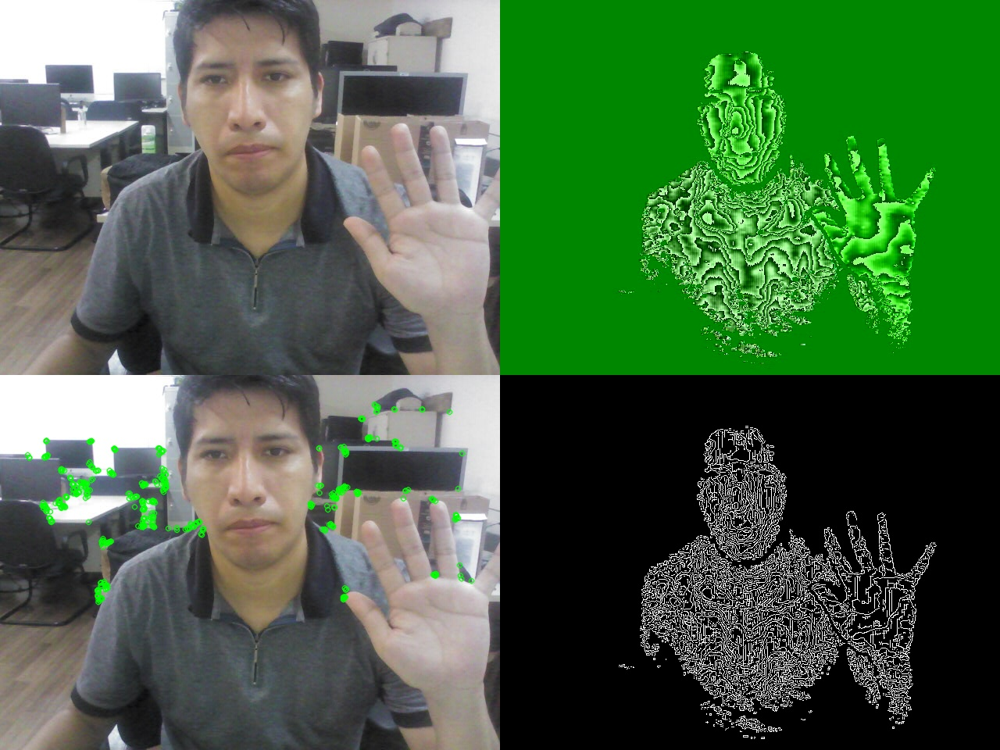

# Pesquisa de Mestrado — Visão Computacional e Rastreamento do Olhar (IME-USP)


Código da pesquisa de mestrado em Ciência da Computação no **Instituto de
Matemática e Estatística da Universidade de São Paulo (IME-USP)**, com bolsa
**CAPES**, sob orientação do **Prof. Dr. Carlos Hitoshi Morimoto**.

A pesquisa trata do **rastreamento do olhar em ambientes naturais**,
combinando câmeras RGB-D, visão computacional em tempo real e um eye tracker
remoto com **iluminação estroboscópica diferencial** (LEDs infravermelhos
sincronizados com a câmera), para segmentar a pupila e o reflexo corneano
(*glint*) e estimar para onde o usuário está olhando.

**Publicação:** *"A Cascade Image-Processing Pipeline for Real-Time Pupil and
Glint Segmentation in Remote Stroboscopic Differential Lighting"* —
submetido ao **ETRA 2027** (em revisão por pares).



*Câmera RGB-D: imagem RGB (sup. esq.), mapa de profundidade (sup. dir.),
pontos-chave ORB (inf. esq.) e bordas Canny sobre a profundidade (inf. dir.).*

## Mapa da pesquisa

Este repositório reúne a **primeira fase** (captura RGB-D, calibração e
extração de características). As fases seguintes estão em repositórios
próprios:

| Repositório | Conteúdo |
|---|---|
| **Pesquisa-USP** (este) | Captura com câmeras RGB-D (Intel RealSense, Kinect) e PS Eye, calibração de câmera, extração de características (ORB, Harris, Shi-Tomasi, Canny, DoG), interfaces de captura e ambiente Docker para ORB-SLAM2 |
| [Differential-Stroboscopic-Eye-Tracker](https://github.com/hard747/Differential-Stroboscopic-Eye-Tracker) | Eye tracker com luz estroboscópica diferencial: sincronização câmera–LEDs, detecção do centro da pupila e dos glints em vídeo |
| [Segmentacao-da-Pupila](https://github.com/hard747/Segmentacao-da-Pupila) | Pipeline de segmentação da pupila e dos glints, calibração do olhar e predição do ponto de fixação, com diagramas UML da arquitetura |
| [Pupil-Segmentation-from-SDL](https://github.com/hard747/Pupil-Segmentation-from-SDL) | Implementação em C++ (CMake) da detecção de pupila e glint, integrando algoritmos clássicos da literatura (ElSe, ExCuSe, Świrski) para comparação |
| [control-luces-estroboscopicas](https://github.com/hard747/control-luces-estroboscopicas) | Firmware Arduino para o controle dos LEDs infravermelhos sincronizado com o obturador da câmera, e scripts de captura |

## Estrutura deste repositório

```
Pesquisa-USP/
├── 01-captura-rgbd/
│   ├── realsense/        # Intel RealSense F200/SR300 (Python + C++)
│   │   └── cpp/
│   ├── kinect/           # Kinect v1 via libfreenect (C++)
│   └── ps-eye/           # Câmera PlayStation Eye: foto, sequência e vídeo
├── 02-calibracao-camera/ # Calibração intrínseca com tabuleiro de xadrez
│   └── imagens/
├── 03-processamento-imagens/  # ORB, Harris, Shi-Tomasi, Canny, DoG, painéis RGB-D
├── 04-interfaces-graficas/    # Captura e processamento com PyQt5 e Tkinter
├── 05-slam/                   # Ambiente Docker com ORB-SLAM2 + RealSense (GPU)
├── dados/
│   ├── exemplos/         # Imagens RGB e de profundidade de exemplo
│   ├── sequencia_ps_eye/ # 50 frames capturados com a PS Eye
│   └── videos/           # Vídeos RGB, em cinza, de profundidade e processado
└── docs/img/
```

## Módulos

### 01 · Captura RGB-D
- **Intel RealSense:** captura de cor e profundidade com `pyrealsense2`,
  inspeção dos sensores e perfis de stream do dispositivo, e versões em C++
  com `librealsense2`. Inclui a versão com a API legada `librealsense` 1.x,
  necessária para os modelos F200 e SR300.
- **Kinect v1:** captura e visualização de RGB e profundidade com
  `libfreenect` e OpenCV.
- **PlayStation Eye:** identificação da câmera pelo ID USB (`1415:2000`) via
  `pyudev`, captura de foto, de sequências de frames e de vídeo.

### 02 · Calibração de câmera
Calibração intrínseca pelo método de Zhang (tabuleiro de xadrez de 11×8 casas, 10×7 cantos internos): estima
a matriz da câmera (fx, fy, cx, cy) e os coeficientes de distorção (k1, k2,
p1, p2, k3), e exporta um YAML no formato de configuração do ORB-SLAM2.

### 03 · Processamento de imagens
- Detectores de pontos de interesse: **ORB**, **Harris** (implementado passo a
  passo, a partir dos gradientes de Sobel e da matriz de autocorrelação) e
  **Shi-Tomasi**.
- **Canny** sobre mapas de profundidade e **Diferença de Gaussianas (DoG)**.
- Painéis sincronizados RGB + profundidade + ORB + Canny, para imagens e vídeo.
- Extração do canal de profundidade de imagens RGB-D com **Open3D**.

### 04 · Interfaces gráficas
Aplicações em **PyQt5** e **Tkinter** para captura em tempo real, gravação
simultânea de vídeo colorido e em cinza (com `QThread`) e processamento
posterior dos vídeos RGB e de profundidade.

### 05 · SLAM
`docker-compose.yml` com um ambiente **ORB-SLAM2** pronto para câmeras
RealSense, com acesso à GPU NVIDIA e à interface gráfica (X11). É a base para
localizar a câmera de cena no ambiente 3D e projetar o olhar sobre ele.

```bash
cd 05-slam
xhost +local:docker
docker compose up -d
docker exec -it orb-slam-container bash
```

## Como executar

```bash
pip install -r requirements.txt

# Calibração com as imagens incluídas (gera calibracion.yaml)
python 02-calibracao-camera/calibracao_tabuleiro.py

# Detecção de cantos de Harris na imagem de exemplo
python 03-processamento-imagens/harris_cantos.py
```

Os scripts de `01-captura-rgbd` e `04-interfaces-graficas` precisam das
câmeras conectadas e foram desenvolvidos em **Linux (Ubuntu)**. Os programas
em C++ dependem de OpenCV, `librealsense2`/`librealsense` ou `libfreenect`.

## Hardware utilizado

| Dispositivo | Uso |
|---|---|
| Intel RealSense F200 / SR300 | Imagens RGB e de profundidade |
| Microsoft Kinect v1 | Imagens RGB e de profundidade |
| Sony PlayStation Eye | Câmera de alta taxa de quadros para captura de vídeo |
| Arduino + LEDs infravermelhos | Iluminação estroboscópica sincronizada ([repositório](https://github.com/hard747/control-luces-estroboscopicas)) |

## Autor

**Harre Bams Ayma Aranda** — Mestre em Ciência da Computação (IME-USP),
Bacharel em Matemática (UNMSM).

[LinkedIn](https://www.linkedin.com/in/harre-bams-ayma-aranda-a71a12236/) ·
[GitHub](https://github.com/hard747) ·
harre@alumni.usp.br
